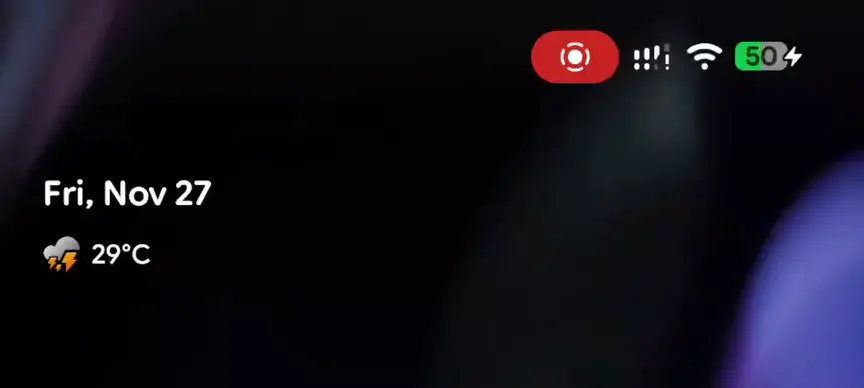

# Now Lyrics

Now Lyrics shows the current track and synced lyrics on Android. It works with music apps that expose track metadata and playback through Android's media session, including Spotify, YouTube Music, Apple Music, Amazon Music, TIDAL, and Deezer. On rooted devices, the optional Vector module shows the current line in the native SystemUI status bar. New lines slide up and fade in. Long lines wait 180 ms, scroll horizontally once, and hold at the end until the lyric changes.

The app reads playback information from Android's media session and uses [LRCLIB](https://lrclib.net/) to find synced lyrics. The info panel shows the lookup outcome.

## Demo



## Install

1. Download the signed APK from [Releases](../../releases) and install it.
2. Open Now Lyrics and grant notification access.
3. For status-bar lyrics, enable **Now Lyrics** in Vector, select **System UI** (`com.android.systemui`) as the module scope, and restart SystemUI or reboot.
4. Play a track in your music app. The status-bar clock returns when playback pauses or no timed line is available.

The app targets Android 8.0 and above. The SystemUI hook was tested on a rooted Pixel 5 running Android 17 with Vector 2.2. Status-bar layouts vary by ROM. The info button in the app shows the active media session, lyrics lookup result, and playback timing.

## Build locally

Use JDK 17 and install Android SDK Platform 36 and Build Tools 36. Open the project in Android Studio or run the Gradle wrapper.

```sh
./gradlew :app:assembleDebug :app:assembleRelease
```

On Windows use `gradlew.bat`. APKs are written to `app/build/outputs/apk/`. The release APK from a local Gradle build is unsigned.

## Publish a release

GitHub Actions builds and checks the app on pushes and pull requests targeting `main`. To publish, update `versionCode` and `versionName` in `app/build.gradle`, push the commit, and push a matching tag such as `v1.7`. The tag build signs the APK, verifies its signature, and publishes it to Releases.

The repository Actions secret `ANDROID_KEYSTORE_BASE64` holds the project's signing keystore. Releases use the same project-local signing certificate as the APK already installed on the test device.
